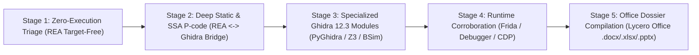

# REA × Ghidra × Lycero Office — Coordinated Reverse Engineering Skill

This skill orchestrates **three specialized systems** on this machine into one deterministic pipeline:

1. **REA (`morluto/rea`)** — Evidence-first multi-engine orchestrator (`D:\rea-upstream-20261028` v6.8.0 source & `D:\rea\scripts\rea.mjs` built CLI/MCP runtime) for fast zero-execution artifact triage, SHA-256 provenance tracking, cross-engine normalization, and dynamic runtime observation.
2. **Ghidra (`NationalSecurityAgency/ghidra`)** — Deep program analysis engine (`D:\ghidra-upstream-20261028` v12.3-DEV) providing **SLEIGH $\rightarrow$ P-code IR lifting** across 39 CPU architectures, the **Native C++ SSA Decompiler**, **`ReaGhidraBridge.java`** headless Unix-socket RPC, **PyGhidra**, **BSim** vector similarity, and **SymbolicSummaryZ3**.
3. **Lycero Office (`lycero-office` CLI & Engines)** — Local document compilation engine (`D:\Lycero Office`) that transforms verified REA/Ghidra JSON Evidence into executive-grade **Word Audit Reports (`.docx`)**, **Spreadsheet Function & Import Matrices (`.xlsx`)**, and **Architecture Slide Decks (`.pptx`)**.

---

## 1. Golden Rules (Epistemology & Safety)

1. **Evidence Triple Separation (`Observed` vs `Inferred` vs `Unknown`):**
   - **Observed:** Exact file bytes, SHA-256 digests, PE/ELF/Mach-O headers, import/export tables, raw disassembly, and recorded runtime traces.
   - **Inferred:** Decompiler C pseudocode (`ClangTokenGroup`), recovered stack structs, `SymbolicPropogator` value-flow constants, Rust/Go/NativeAOT heuristic symbol recovery. Never claim decompiled C is the original source code.
   - **Unknown:** Uninitialized memory slots, unresolved indirect calls (`CALLIND`), stripped sections, or unexecuted branches. Never replace unknown coverage with "absent" or zero-filled assumptions.
2. **Summary-First & Graph-Bounded Queries:**
   - Always request `detail: "summary"` first on large binaries, ASAR bundles, or call graphs.
   - Retain `parent_evidence_id` and page specific facets via `inspect_analysis_view` instead of dumping multi-megabyte JSON into the LLM context window.
   - Respect `ReaGhidraBridge` safety bounds (`MAX_HIGH_PCODE_OPS = 3000`, `MAX_HIGH_PCODE_DEF_USE_EDGES = 12000`, `MAX_DECOMPILE_CHARS = 160000`).
3. **Zero Unintended Execution:**
   - Static inspection tools (`inspect_*`, `open_binary`, `analyze_function`, `procedure_pseudo_code`) **never execute** the target binary.
   - Only launch dynamic runtime tools (`observe_native_calls`, Frida, LLDB/GDB/CDB, `capture_browser_scenario`) when static evidence cannot answer the question and the user has authorized live execution.

---

## 2. The 5-Stage Coordinated Workflow



### Stage 1: Fast Zero-Execution Triage (No Disassembler Required)
Before spinning up a heavy Ghidra headless JVM, classify the artifact and extract structural metadata using REA's target-free inspectors or the coordinated triage script:

```powershell
# Run the coordinated triage helper script on any binary/package:
node "D:\Lycero Office\.agents\skills\rea-ghidra-reverse\scripts\rea-ghidra-triage.mjs" <path-to-target> --out-dir <output-folder>
```

Or route directly by target type using `node "D:\rea\scripts\rea.mjs"` / MCP tools:
- **Desktop installation folder:** `inspect_desktop_application` (`detail: "summary"`)
- **Electron `.asar` or JS bundle:** `analyze_javascript_application` (uses Wakaru AST deobfuscator & sourcemaps)
- **Windows PE32/PE32+:** `inspect_pe_imports`, `inspect_pe_certificates`, `inspect_pe_load_config` (TLS callbacks, CFG/XFG), `inspect_pe_resources`, `inspect_native_exports`
- **Linux ELF / Kernel Module:** `inspect_binary_layout`, `inspect_elf_notes`, `inspect_kernel_module`, `inspect_native_exports`
- **macOS Mach-O / `.app` / `.ips`:** `inspect_macho` (`detail: "summary"`), `open_bundle_resources` (`inspect_plist`, `inspect_asset_catalog`), `inspect_apple_ips`
- **Rust / Go / .NET / Unity IL2CPP / Python:**
  - Rust `.dep-v0` crates: `inspect_rust_binary`
  - Go `buildinfo` & modules: `inspect_go_binary`
  - .NET CIL assembly: `inspect_managed_artifact` & `inspect_managed_members`
  - Unity `global-metadata.dat`: `inspect_il2cpp_metadata`
  - Python `.pyc` / PyInstaller: `inspect_python_pyc` / `open_binary` + `inspect_artifact`
- **Android APK / AAB:** `inspect_apk_signature` (v1/v2/v3/v3.1 certs & lineage) + `inspect_android_package` (JADX)
- **AI Models / Databases / Captures:** `inspect_model_artifact` (GGUF/safetensors), `inspect_sqlite_database`, `inspect_wasm_artifact`, `inspect_pcap_capture`, `inspect_web_network_capture` (HAR/SAZ/qlog)

### Stage 2: Deep Static Analysis & SSA P-code via `ReaGhidraBridge`
When the question requires function control-flow, decompilation, cross-references, stack frame recovery, or register/variable data-flow:

1. **Bind Target & Check Capabilities:**
   - Call `open_binary` with `provider_id: "ghidra"` (or inspect `binary_session` with `{}`).
   - `ReaGhidraBridge.java` (`D:\rea-upstream-20261028\bridge\ghidra\ReaGhidraBridge.java`) creates an **ephemeral read-only project copy** and opens a local authenticated **Unix Domain Socket** to the headless JVM + Native C++ Decompiler process.
2. **Locate Procedures & XRefs:**
   - Search symbols/strings first: `search_strings`, `list_procedures`, `list_names`, `xrefs`.
   - Use `procedure_address`, `procedure_callers`, `procedure_callees`, or `get_call_graph` (`detail: "summary"`).
3. **Decompile & Inspect SSA High P-code (`analyze_function`):**
   - Call `analyze_function` (returns summary + `parent_evidence_id`).
   - Page specific facets via `inspect_analysis_view` (`kind: "native"`):
     - `facet: "pseudocode"` — C output from Ghidra's C++ `printc.hh` engine.
     - `facet: "value_flow_operations"` / `facet: "value_flow_summary"` — SSA `HighFunction` `Varnode` Def-Use edges, $\phi$-nodes (`MULTIEQUAL`), and `SymbolicPropogator` constant propagation.
     - `facet: "basic_blocks"`, `"references"`, `"unresolved_calls"`, `"referenced_strings"`.
   - When decompiled C hides low-level bit manipulation or compiler intrinsics, **always inspect the SSA P-code facet** (`COPY`, `LOAD`, `STORE`, `INT_ADD`, `SUBPIECE`, `PTRSUB`, `PTRADD`, `CALLIND`).
4. **Cross-Version Binary Diffing (`match_native_functions` & `compare_functions`):**
   - Collect `list_procedures` and selected `analyze_function` dossiers (`parent_evidence_id`) from `v1` and `v2`.
   - Run `match_native_functions` followed by `compare_functions` to pinpoint exact patched basic blocks, added security checks, or altered constants.

### Stage 3: Specialized Ghidra 12.3 Engines (When Standard Bridge Is Not Enough)
Consult [references/ghidra-pcode-and-bridge.md](references/ghidra-pcode-and-bridge.md) when you need to invoke or inspect Ghidra 12.3's specialized capabilities in `D:\ghidra-upstream-20261028`:
- **Modern Language Recovery:**
  - **Rust (`Ghidra/Features/Rust`):** `RustDemanglerV0`, non-null-terminated `(ptr, len)` string slice recovery, `cdecl-rust` ABI.
  - **Swift (`Ghidra/Features/Swift`):** `__swift5_types` / `__swift5_fieldmd` struct & protocol recovery.
  - **Golang (`Ghidra/Features/GhidraGo`):** `gopclntab` function & runtime type recovery on stripped binaries.
  - **.NET NativeAOT (`NativeAotExtension.java`):** MethodTable, FrozenString, and ReadyToRun header parsing.
- **Z3 Symbolic Execution (`Ghidra/Extensions/SymbolicSummaryZ3`):**
  - Use `SymZ3PcodeEmulator` to solve branch constraints over P-code bitvectors.
- **Taint Analysis (`Ghidra/Debug/TaintAnalysis`):**
  - Track attacker-controlled input buffers through P-code `LOAD`/`STORE`/`INT_*` operations.
- **BSim Behavioral Vector Similarity (`Ghidra/Features/BSim`):**
  - Match stripped library functions across architectures (`x86_64` $\leftrightarrow$ `AARCH64` $\leftrightarrow$ `RISCV`) using LSH feature vectors of High P-code dataflow.

### Stage 4: Dynamic Runtime Corroboration
When static analysis leaves `unknown` indirect calls (`CALLIND`), packed/encrypted payloads, or runtime-only state:
- **Native execution tracing:** `observe_native_calls` (LLDB/GDB/CDB/Frida) with explicit module-scoped breakpoints and bounded `duration_ms` / `max_events`.
- **Electron / Web runtime:** Check `inspect_electron_fuses` first, then `list_electron_targets` or `capture_browser_scenario` (`export_environment_bundle` for AgentEnv).

### Stage 5: Automated Technical Dossier Generation with `Lycero Office`
Whenever the user wants a report, spreadsheet matrix, or presentation from reverse-engineering findings, pipe the verified REA/Ghidra Evidence into `lycero-office` (see full schemas in [references/office-dossier-pipeline.md](references/office-dossier-pipeline.md)):

1. **Workbook Matrix (`.xlsx`):**
   - Export procedures, imports, exports, cryptographic constants, and findings into JSON/CSV.
   - Run `lycero-office create --type xlsx --from <table.json> --header --out <report.xlsx> --json` and `lycero-office sheet check <report.xlsx> --json`.
2. **Technical Audit Report (`.docx`):**
   - Compile Executive Summary, Target Identity (SHA-256), Architecture Breakdown, Decompiled C + P-code Evidence Tables, and Vulnerability Findings into Markdown.
   - Run `lycero-office create --type docx --from <audit.md> --out <audit.docx> --json` and `lycero-office docs check <audit.docx> --json`.
3. **Architecture & Reverse Engineering Briefing Deck (`.pptx`):**
   - Build slide specs (`outline.json` + `page-*.json`) following Astryx warm editorial palette (`#F4F2EB` background, `#1C1B18` ink, `#8B3A1A` terracotta accent).
   - Run `lycero-office create --type pptx --spec <spec-dir> --out <briefing.pptx> --json` and `lycero-office slides audit <briefing.pptx> --json`.

---

## 3. Detailed Reference Guides

Load only the reference file needed for your current step:
- [references/ghidra-pcode-and-bridge.md](references/ghidra-pcode-and-bridge.md) — Ghidra 12.3 internals (`D:\ghidra-upstream-20261028`), C++ Decompiler pipeline, P-code opcodes, `ReaGhidraBridge.java` protocol, and PyGhidra scripting.
- [references/rea-workflow-and-evidence.md](references/rea-workflow-and-evidence.md) — REA v6.8.0 (`D:\rea-upstream-20261028` & `D:\rea`) CLI/MCP routing, summary-first paging, deadline recovery, and binary diffing.
- [references/office-dossier-pipeline.md](references/office-dossier-pipeline.md) — Templates and automated workflows for turning REA/Ghidra JSON Evidence into `.docx`, `.xlsx`, and `.pptx` deliverables via Lycero Office.
