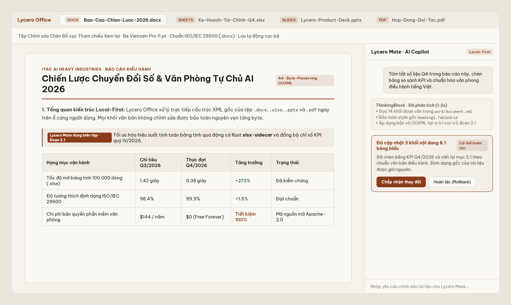
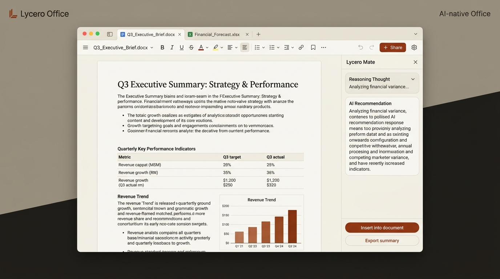
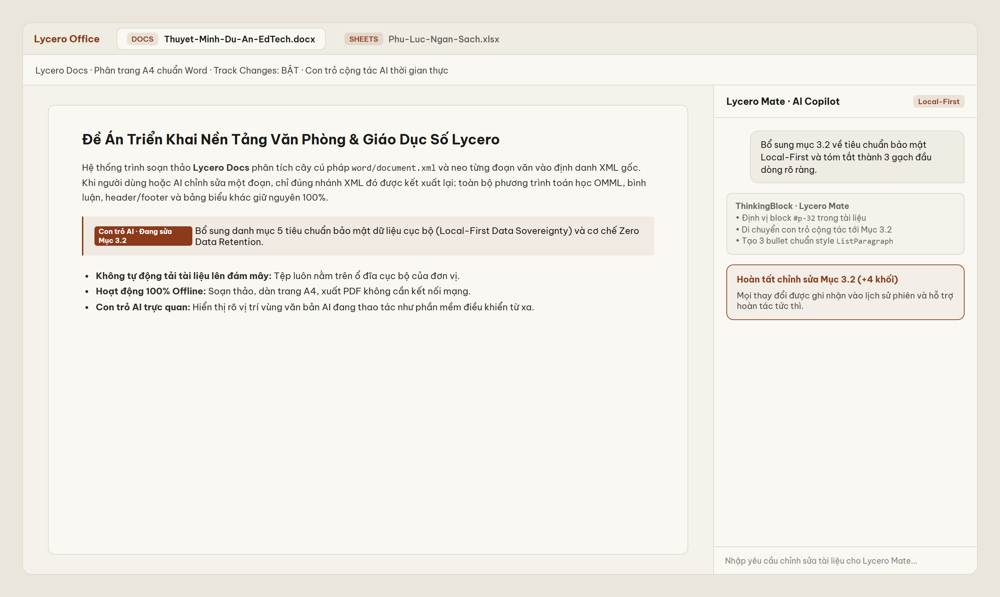
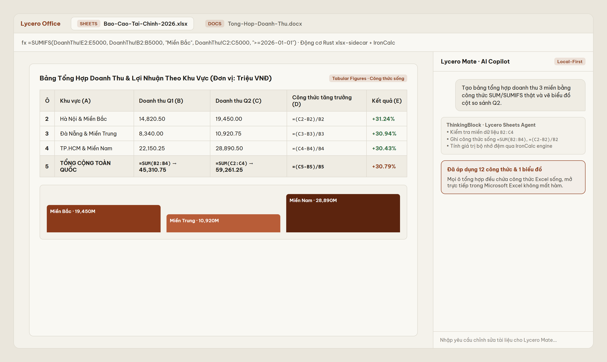
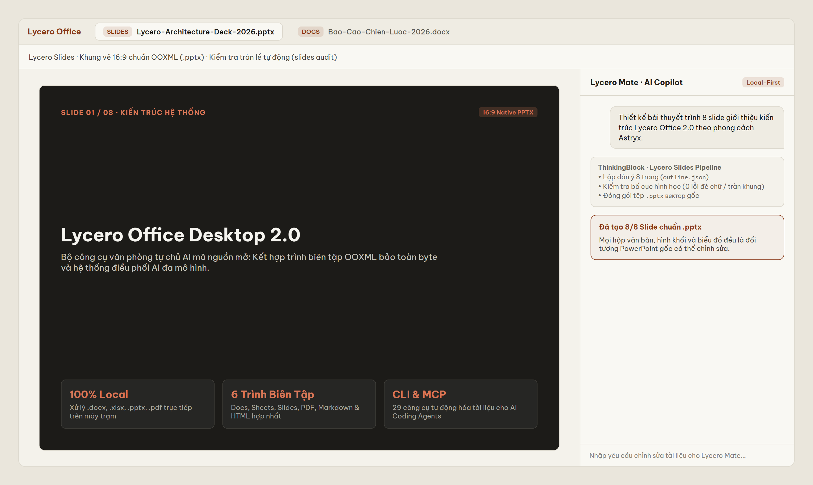
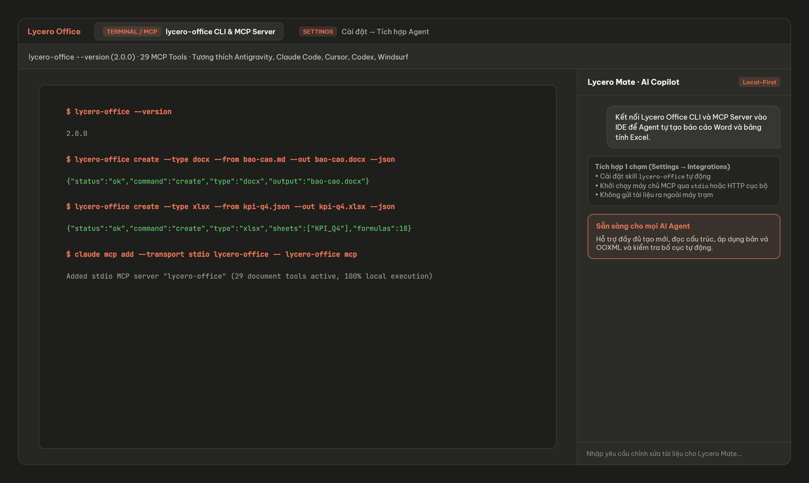

  <a href="https://lycero.com/">
    <picture>
      <source srcset="../assets/readme/hero-dark.png" media="(prefers-color-scheme: dark)">
      
    </picture>
  </a>

<h1 align="center">Lycero Office Desktop</h1>

  <b>Bộ Công Cụ Văn Phòng & Giáo Dục Tự Chủ AI Mã Nguồn Mở Cho Windows, macOS & Linux</b> 
  Biên tập trực tiếp các tệp <code>.docx</code>, <code>.xlsx</code>, <code>.pptx</code>, <code>.pdf</code>, <code>.md</code> và <code>.html</code> theo chuẩn thiết kế Astryx chống mỏi mắt, tích hợp trợ lý <b>Lycero Mate</b>, công cụ dòng lệnh <code>lycero-office</code> và máy chủ MCP.

  <b>Giấy phép:</b> <a href="../../LICENSE">Apache-2.0</a> ·
  <a href="../../README.md"><b>English</b></a> ·
  <b>Tiếng Việt</b>

<!-- public-hygiene: allow -->

---

**Lycero Office** là bộ phần mềm văn phòng mã nguồn mở miễn phí do **ITAC AI Heavy Industries** phát triển cho Windows (`x64` & 32-bit `ia32`), macOS (Apple Silicon `arm64` & Intel `x64`) và Linux (`AppImage`, `.deb`, `.rpm`). Ứng dụng mở, chỉnh sửa và lưu trực tiếp định dạng gốc `.docx`, `.xlsx`, `.pptx`, `.pdf`, `.md`, `.html` ngay trên ổ đĩa cục bộ của bạn, kết hợp cùng trợ lý AI **Lycero Mate** hỗ trợ thao tác trực tiếp trên tài liệu với con trỏ cộng tác thời gian thực và hoàn tác 1 chạm.

### Điểm Khác Biệt Cốt Lõi

- **Bảo toàn cấu trúc Byte-for-Byte (`.docx`, `.xlsx`, `.pptx`):** Chỉ những khối XML được bạn hoặc AI chỉnh sửa mới được ghi lại; mọi định dạng, công thức toán học OMML, bảng biểu, biểu đồ và slide master còn lại được giữ nguyên 100% khi mở lại trên Microsoft Word, Excel, PowerPoint.
- **Ngôn ngữ thiết kế Astryx bảo vệ thị lực:** Bảng màu **Matte Warm Ivory (`#F4F2EB`) & Warm Terracotta (`#8B3A1A`)** cho ban ngày và **Claude-Warm Charcoal (`#262624`) & Radiant Terracotta (`#D97757`)** cho ban đêm, sử dụng phông chữ chuẩn tiếng Việt `Be Vietnam Pro`.
- **100% Local-First & Hoạt động Offline:** Toàn bộ tính năng soạn thảo văn bản, tính toán bảng tính (động cơ Rust `xlsx-sidecar`), thiết kế trình chiếu, chỉnh sửa PDF và chuyển đổi định dạng hoạt động hoàn toàn trên máy trạm không cần Internet.
- **Lycero Mate Copilot & Đa nhà cung cấp AI:** Đăng nhập tài khoản **Lycero** để sử dụng ngay hoặc tự cấu hình API Key riêng (OpenAI, Claude, Gemini, DeepSeek, Qwen, GLM, Mistral, OpenRouter, Ollama).

---

## Trình Diễn Giao Diện & Tính Năng

  <picture>
    <source srcset="../assets/readme/ai-hero-dark.jpg" media="(prefers-color-scheme: dark)">
    
  </picture>

### 1 · Lycero Docs — Soạn thảo `.docx` phân trang A4 kèm con trỏ AI trực quan

  

### 2 · Lycero Sheets — Bảng tính `.xlsx` tốc độ cao với động cơ Rust & công thức sống

  

### 3 · Lycero Slides — Thiết kế bài thuyết trình `.pptx` 16:9 & kiểm tra bố cục tự động

  

### 4 · Dòng lệnh `lycero-office` CLI & Máy chủ MCP (29 công cụ)

  

---

## Tải Về Bản Cài Đặt

Tất cả bộ cài đặt chính thức cho Windows, macOS (Intel & Apple Silicon) và Linux được phát hành tại [GitHub Releases](https://github.com/ITACAHI/lycero-office/releases/latest).

## Chính Sách Ký Số & Bản Quyền

Free code signing on Windows is provided by [SignPath.io](https://signpath.io/), certificate by [SignPath Foundation](https://signpath.org/).

- Bản quyền © 2026 **ITAC AI Heavy Industries**. Phát hành theo giấy phép [Apache License, Version 2.0](../../LICENSE).
- Tuân thủ Điều 4 Giấy phép Apache 2.0: Xem chi tiết thông báo pháp lý và nguồn gốc mã nguồn mở tại [LICENSE](../../LICENSE), [NOTICE](../../NOTICE) và [LEGAL_AND_IP_COMPLIANCE.md](../../LEGAL_AND_IP_COMPLIANCE.md).
